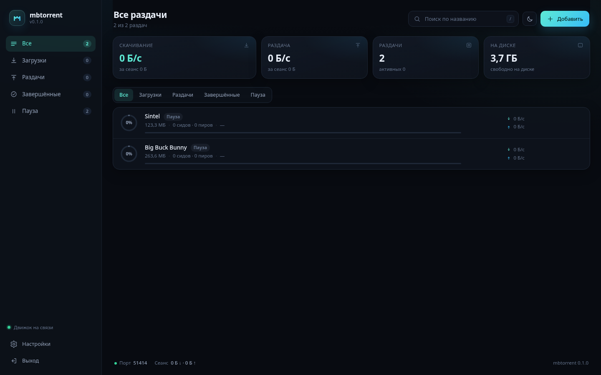

# mbtorrent

**Неофициальный форк qBittorrent для Windows: один `.exe`, без Qt, без установщика, без зависимостей.**

[](https://github.com/Skaffall/mbtorrent/releases/latest)
[](LICENSE)
[](#скачать)
[](https://go.dev)
[](#почему-без-qt)

[English version](README.en.md) · [Скачать](https://github.com/Skaffall/mbtorrent/releases/latest) · [Как собрать](#сборка) · [HTTP API](#http-api)



---

> ## 🧩 Это форк qBittorrent
>
> **mbtorrent — неофициальный форк qBittorrent.** Мы берём у qBittorrent то, за что его
> любят: чистый список раздач, понятные настройки, горячие клавиши и поведение
> «клиент живёт в фоне». Это форк **идеи и пользовательского опыта**, а не кода:
> оригинальный qBittorrent написан на C++/Qt, а mbtorrent — самостоятельная
> реимплементация на Go с интерфейсом на HTML/CSS/JS.
>
> * Мы **не связаны** с авторами qBittorrent и не претендуем на их имя.
> * qBittorrent — проект [qbittorrent.org](https://www.qbittorrent.org/) и его авторов;
>   все права на название и оригинальный код принадлежат им.
> * Код qBittorrent здесь не используется. Движок — [`anacrolix/torrent`](https://github.com/anacrolix/torrent) (MPL-2.0).
>
> Если вам нужен оригинальный qBittorrent со всеми функциями — скачайте его
> [здесь](https://www.qbittorrent.org/download). Если нужен лёгкий клиент на 20 МБ,
> который запускается двойным кликом и не тянет за собой Qt, — это mbtorrent.

## Скачать

1. Откройте [последний релиз](https://github.com/Skaffall/mbtorrent/releases/latest).
2. Скачайте `mbtorrent.exe` (x64) или `mbtorrent-arm64.exe`.
3. Запустите. Браузер откроет панель на `http://127.0.0.1:8642`.

Установка не нужна: файл можно положить в любую папку и запускать оттуда.
Приложение работает в фоне, пока вы не нажмёте «Выход» в панели.

> Windows SmartScreen может предупредить о неизвестном издателе: бинарник собран
> из исходников этого репозитория и не подписан платным сертификатом. Собрать
> самому — [одна команда](#сборка).

## Что это

```
mbtorrent.exe   ≈ 21 МБ   движок + интерфейс + иконки
```

Лёгкий BitTorrent-клиент только для Windows. Внутри — Go-движок и локальная
веб-панель, вшитая в бинарник через `go:embed`. Никаких DLL, установщиков,
Electron, .NET и Qt.

| | qBittorrent | mbtorrent |
|---|---|---|
| Интерфейс | Qt6 Widgets | HTML/CSS/JS в браузере |
| Размер поставки | десятки МБ + Qt DLL | один `.exe` ≈ 21 МБ |
| Установка | установщик | не нужна |
| Движок | libtorrent-rasterbar (C++) | `anacrolix/torrent` (Go) |
| Платформы | Windows, Linux, macOS | Windows 10/11 (x64, ARM64) |
| Функций | максимум | необходимый минимум |

## Что умеет

- magnet-ссылки, `.torrent`-файлы и http(s)-ссылки на `.torrent`
- DHT, PEX, трекеры, шифрование заголовков (MSE), uTP/TCP
- пауза/продолжение, проверка файлов, удаление с файлами или без
- лимиты скорости, смена папки загрузок и портов на лету
- сохранение прогресса между запусками **без повторного хеширования**
- тёмная и светлая темы, поиск, фильтры, drag & drop, детали раздачи со списком файлов
- интерфейс на русском, полностью офлайн (ни одного CDN-запроса)
- один экземпляр: повторный запуск просто открывает уже работающую панель

## Почему без Qt

qBittorrent — это C++/Qt Widgets: весь интерфейс, диалоги и трей построены на Qt6.
Собрать его «без тяжёлых виджетов Qt6» нельзя — можно только выкинуть интерфейс
целиком (получится `qbittorrent-nox`, которого под Windows официально нет, и всё
равно останутся QtCore/QtNetwork/QtSql).

Поэтому здесь использованы лазейки:

| Что обычно тяжело | Чем заменено |
|---|---|
| Qt6 Widgets (~80–150 МБ DLL) | HTML/CSS/JS, вшитый в exe через `go:embed` |
| libtorrent-rasterbar (C++, Boost) | [`anacrolix/torrent`](https://github.com/anacrolix/torrent) — чистый Go, без cgo |
| Установщик и рантаймы | один статический `.exe`, `CGO_ENABLED=0` |
| Трей и нативный GUI | браузер по умолчанию (на Windows 10/11 это Edge/WebView2, уже установлен) |
| Перехеширование при старте | bolt-база завершённых кусков (`%AppData%\mbtorrent\resume`) |
| Второй экземпляр клиента | пинг своего же порта → просто открывает панель |

Идея, горячие клавиши и структура экрана — в духе qBittorrent, но код полностью свой.

## Сборка

Нужен только [Go](https://go.dev/dl/) 1.24+.

**Windows (PowerShell):**

```powershell
.\build.ps1
# → dist\mbtorrent.exe
```

**Linux/macOS (кросс-сборка, amd64 + arm64):**

```bash
./build.sh
# → dist/mbtorrent.exe  (amd64) и dist/mbtorrent-arm64.exe
```

Флаги сборки: `-H=windowsgui` (нет чёрного окна консоли), `-s -w` (меньше размер).
Иконка вшивается через `.syso`-файлы, поэтому `rsrc_windows_*.syso` лежат в репозитории.

## Запуск

Двойной клик по `mbtorrent.exe` → откроется браузер с панелью.
Повторный запуск не поднимает второй клиент — просто открывает уже работающую панель.
Приложение продолжает работать в фоне, пока вы не нажмёте «Выход» в панели
(закрытие вкладки браузера его не останавливает).

> Порт BitTorrent по умолчанию выбирается автоматически (0 в настройках).
> Если нужен проброс порта на роутере — задайте постоянный, например 51413.

Полезные ключи:

```text
-port 8642      порт панели (по умолчанию 8642)
-no-browser     не открывать браузер
-debug          подробный лог в консоль
-version        показать версию
```

## Проверка

```bash
CGO_ENABLED=0 go test ./...
```

Тест поднимает два клиента в одном процессе (сидер и личер), скачивает файл
по настоящему BitTorrent-протоколу и сверяет байты. Интернет не нужен.

## Горячие клавиши

| Клавиша | Действие |
|---|---|
| `Ctrl+N` | добавить раздачу |
| `/` | поиск |
| `Ctrl+V` | вставить magnet из буфера и открыть добавление |
| `Esc` | закрыть окно/панель |

## Где лежат данные

Всё в `%AppData%\mbtorrent`:

```
config.json        настройки
state.json         список раздач (magnet, .torrent, пауза)
torrents\*.torrent сохранённые метаданные
resume\            база завершённых кусков (не удаляйте — иначе перехеширование)
mbtorrent.log      лог (ротация на 5 МБ)
```

Загрузки по умолчанию: `%UserProfile%\Downloads\mbtorrent`.

## HTTP API

Панель общается с движком по локальному JSON API. Он же доступен вашим скриптам:

| Метод | Путь | Назначение |
|---|---|---|
| GET | `/api/state` | список раздач, скорости, настройки |
| GET | `/api/ping` | проверка «это mbtorrent?» |
| POST | `/api/torrents` | `{magnet\|url\|torrent(base64), paused}` |
| POST | `/api/torrents/{hash}/pause` | пауза |
| POST | `/api/torrents/{hash}/resume` | продолжить |
| POST | `/api/torrents/{hash}/recheck` | проверить файлы |
| POST | `/api/torrents/{hash}/reveal` | открыть папку в проводнике |
| POST | `/api/torrents/{hash}/remove?delete_data=1` | удалить |
| GET | `/api/torrents/{hash}/files` | файлы раздачи |
| GET/PUT | `/api/settings` | настройки |
| POST | `/api/quit` | корректно закрыть клиент |

Сервер слушает только `127.0.0.1`. Изменяющие запросы требуют заголовок
`X-MBTorrent: 1` и `Content-Type: application/json` — это отсекает CSRF с чужих сайтов.
Порт панели меняется в настройках и применяется после перезапуска.

## Ограничения v0.1

- нет трея и автозапуска (GUI-сборка просто живёт в фоне, пока открыта панель);
- нет RSS, поиска по трекерам, последовательной загрузки и выбора отдельных файлов;
- нет прокси и IP-фильтров;
- один профиль настроек, без «категорий» и меток;
- DHT включается автоматически, отдельной кнопки нет.

Всё это — следующие шаги, архитектура к ним готова.

## Структура

```
main.go                  запуск, single-instance, логи, браузер
internal/config          настройки и пути
internal/engine          движок, состояние, resume, скорости
internal/api             JSON API, защита, статика
internal/platform        Win32: браузер, проводник, место на диске, MessageBox
web/assets               index.html, style.css, app.js (вшиваются в exe)
```

## Лицензия и благодарности

- Код mbtorrent — [MIT](LICENSE).
- Движок [`anacrolix/torrent`](https://github.com/anacrolix/torrent) — MPL-2.0.
- Вдохновение, UX и название-ориентир — [qBittorrent](https://www.qbittorrent.org/).
  mbtorrent не связан с проектом qBittorrent; см. [THIRD_PARTY_NOTICES.md](THIRD_PARTY_NOTICES.md).

Если проект оказался полезен — поставьте ⭐. Это лучший способ помочь ему стать заметнее.
